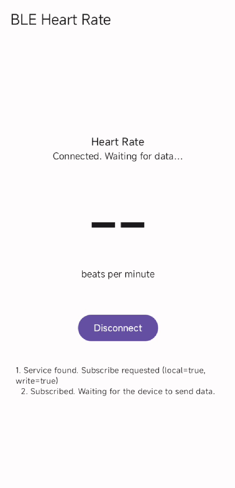
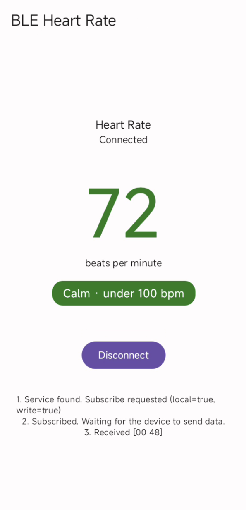
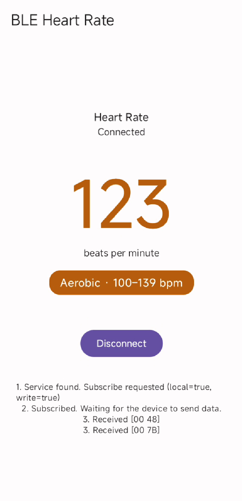
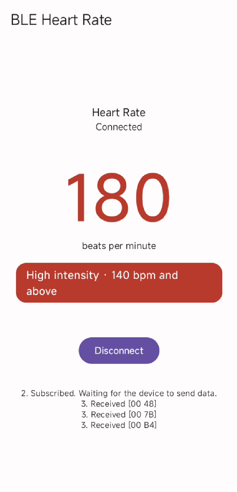
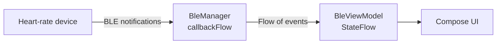

# BLE Heart Rate Monitor

An Android app that connects to a Bluetooth Low Energy (BLE) heart-rate device and shows the live heart rate, color-coded by intensity zone.

Built with **Kotlin**, **Jetpack Compose**, **MVVM**, and **Coroutines / Flow**.

## Features

- Scan for nearby BLE devices and connect over GATT
- Live heart rate from the standard Heart Rate Service
- Color-coded zones: calm (green), aerobic (orange), high intensity (red)
- On-screen debug panel showing each BLE step and the raw bytes received
- Unit tests for the heart-rate parser and the zone boundaries

## Screenshots

| Waiting | Calm | Aerobic | High intensity |
| :-: | :-: | :-: | :-: |
|  |  |  |  |

## Run it

1. Open the project in Android Studio and let Gradle sync.
2. Connect a **physical Android phone** (Android 8.0+, USB debugging on). Emulators do not support BLE.
3. Press **Run**, allow Bluetooth access, tap **Start scan**, and tap a heart-rate device.

## Try it without a heart-rate monitor

1. On a second phone, install **LightBlue** and switch on **Virtual Devices → Heart Rate**.
2. Scan with this app and connect to that phone.
3. Send a value in LightBlue and watch the app update:
   - `00 48` is 72 bpm, shown as Calm
   - `00 78` is 120 bpm, shown as Aerobic
   - `00 B4` is 180 bpm, shown as High intensity

## How it works

The app scans, connects, finds the heart-rate characteristic, and asks the device to send notifications. Each notification is parsed and flows through `StateFlow` to the screen.

## Key files

- `ble/BleManager.kt`: scan, connect, and notifications as Kotlin Flows
- `ble/HeartRateParser.kt`: decodes the heart-rate bytes
- `ui/BleViewModel.kt`: screen state (MVVM)
- `ui/HeartRateZone.kt`: maps a reading to a zone

## Limitations

- Tested with a simulated device (LightBlue on an iPhone), not yet with a physical chest strap or watch.
- Zones are fixed thresholds for display only, not medical advice.
- No pairing flow, automatic reconnect, or background operation.